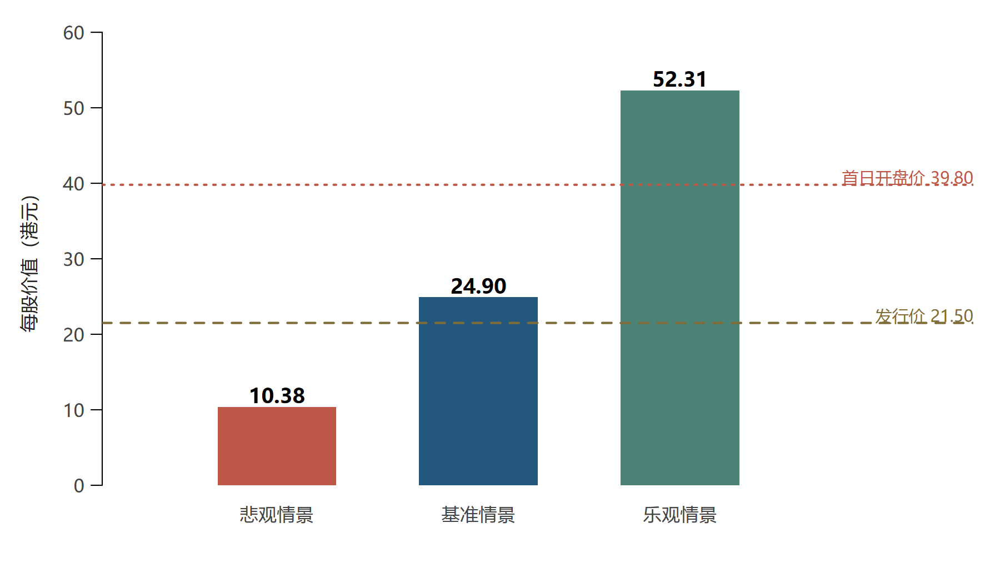
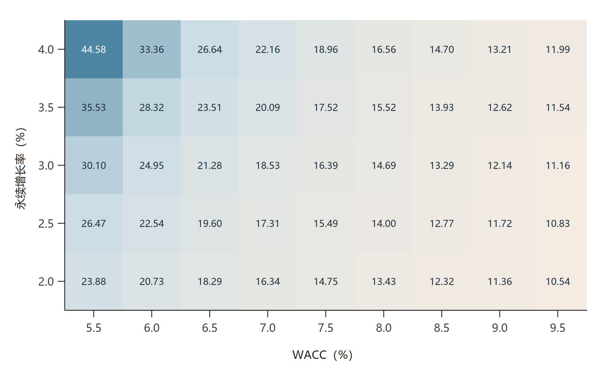

```{r}
#| label: setup
#| include: false
if (.Platform$OS.type == "windows") invisible(Sys.setlocale("LC_CTYPE", ".UTF-8"))
source("code/03_valuation.R", encoding = "UTF-8")
source("code/04_figures.R", encoding = "UTF-8")
source("report_config.R", encoding = "UTF-8")
num <- function(x, d=2) formatC(x, format="f", digits=d, big.mark=",")
pct <- function(x, d=2) paste0(num(x*100,d),"%")
kt <- function(x, digits=2) {
  knitr::kable(x, digits=digits, row.names=FALSE,
    format=if(knitr::is_latex_output()) "latex" else "pipe",
    booktabs=TRUE, escape=TRUE)
}
forecast_table <- function(years) {
  f <- forecast_base[forecast_base$year %in% years,]
  rows <- rbind(f$revenue, f$ebit, f$nopat, f$da, f$capex,
                f$invested_wc, f$delta_wc, f$fcff_annual,
                f$fcff_included, f$pv_fcff)
  out <- data.frame(项目=c("营业收入","EBIT","税后经营利润","折旧摊销",
    "资本开支","投入营运资本","营运资本增加","全年 FCFF","纳入估值的 FCFF","FCFF 现值"),
    as.data.frame(round(rows,2)), check.names=FALSE)
  names(out)[-1] <- paste0(years,"E")
  kt(out)
}
```

\clearpage

# 摘要 {.unnumbered}

本文围绕农夫山泉从接受 A 股上市辅导到最终赴港上市的过程，分析企业上市需求如何随着经营条件变化而改变，并以 2020 年 9 月 8 日为估值时点，运用企业自由现金流折现模型判断发行价与首日开盘价的合理性。分析以课程案例为起点，以当年招股章程和配发结果公告校核财务数据，预测期为 2020 至 2029 年，随后进入稳定增长阶段。

本文认为，2008 年启动 A 股上市准备主要是为了缓解价格竞争、产能扩张及渠道建设带来的融资压力。此后回款效率和现金创造能力提高，使即时上市的必要性下降，长期辅导则保留了未来进入资本市场的选择。2020 年上市的目的包括建立持续融资平台、支持产能和渠道升级、提升国际认知，以及在少量稀释控制权的情况下实现股份流通安排。

采用同行估计的贝塔后，基准股权价值为人民币 `r num(base$equity_value)` 亿元，折合每股 `r num(base$price_hkd)` 港元。21.50 港元发行价较基准值折价 `r pct(-base$offer_premium)`，39.80 港元开盘价较基准值溢价 `r pct(base$opening_premium)`。悲观、基准、乐观情景分别得到 `r num(models$bear$summary$price_hkd)`、`r num(base$price_hkd)`、`r num(models$bull$summary$price_hkd)` 港元。发行价低于基准估值，开盘价则需要更乐观的经营或资本成本条件支持。

# 引言与分析口径

农夫山泉的上市过程提出了两个相互关联的问题：一家现金充裕的企业为什么仍然需要上市，以及一家经营质量较高的企业是否值得任何价格。这两者需要分别从融资决策和资产定价角度回答。企业可以因战略需要选择上市，但上市成功和认购踊跃并不能直接证明交易价格等于内在价值。

本报告依次回答作业的五个问题，并建立模型对农夫山泉公司进行估值。由于农夫山泉的现金分红包含较大的特殊分配，本文因此采用 FCFF 模型进行估值。

估值时点为 2020 年 9 月 8 日上市开始时，经营预测仅使用此前已披露的资料，不使用后来公布的 2020 年全年实际业绩或其后年份数据。2017 至 2019 年为历史实际值，2020 至 2029 年均为上市时视角下的预测值；其中 2020 年只将上市日后的现金流纳入折现。金额统一以人民币亿元表示，股数以亿股表示，每股价值最终换算为港元，发行价和首日开盘价分别比较。

本报告仅展示关键结果，详细数据、分析代码与中间计算结果见https://github.com/tongmmm/investments-lab4

# IPO 的含义与 2008 年选择 A 股的原因

## IPO 的含义

IPO 是首次公开发行股票，即企业首次向公众投资者发行股票，并通常申请在证券交易所上市交易。新股发行募集的资金进入公司，原股东则承担股权比例稀释。上市还使股票具备公开定价、交易和后续融资的制度基础，但同时带来信息披露、治理约束、中介费用及市场价格波动。

应当区分上市准备、提交申请和完成发行。农夫山泉在 2008 年签订上市合作及辅导协议，表示其开始准备进入资本市场，并不代表当年已经申报、获得核准或完成 IPO。

## 2008年选择IPO的原因

首先，瓶装水价格战使其同时承受利润和现金流压力。竞争对手通过扩张产能和渠道抢占市场，农夫山泉需要维持品牌差异化，也需要投入资金改善成本结构。若仅依赖短期借款，长期建厂项目与短期还款责任之间容易出现期限错配。

其次，天然水业务对水源和生产半径的依赖，使扩张必须落实为新的水源地、灌装厂与物流设施。案例提出的运输半径经验说明，扩大覆盖范围并非只增加广告费用，还需要持续的实物资本投入。股权资本没有固定还本付息安排，较适合承担这一阶段的长期扩张风险。

再次，渠道整顿本身需要资金支持。案例记载，2006 年末曾出现促销垫付和运输补贴拖欠导致经销商关系紧张的情况。仓储配送、运输设备及渠道管理系统的建设，均可能在形成收益之前先占用现金。因此，2008 年上市准备具有解决“增长需要投入、但投入又压缩流动性”这一问题的现实基础。

## 为什么当时倾向 A 股

农夫山泉的生产、销售和品牌认知主要位于境内，A 股投资者相对熟悉其产品，募集人民币资金也与境内支出的货币类型相匹配。公司已经是境内股份有限公司，与境内券商开展辅导，有利于在熟悉的监管、会计和法律环境中推进规范化。

这些优势说明 A 股在当时具有业务与融资用途上的匹配性。

# 接受多年辅导却未递交申请的原因

## 内部现金流改善降低了立即融资的必要性

案例显示，农夫山泉通过扩大水源布局、更新生产线及改革供应链，逐步改善经营。对经销商实行款到发货并加强区域管理，有利于缩短回款周期；生产规模扩大与设备升级则降低单位生产成本。公司市场份额由 2008 年的 7.21% 提高至 2016 年的 19.28%，说明其在竞争中逐渐取得更强的位置。

上市必要性取决于未来资金缺口，而不是企业规模是否足够大。当经营现金流能够支持较多投资时，发行股份的即时收益减少，稀释控制权、披露商业信息及持续合规等成本却仍然存在。因此，从此前“选择上市准备”到后来“选择暂不申报”，是同一企业在不同经营状态下的合理选择。

## 辅导具有规范经营与保留选择权的价值

接受辅导并不要求企业立即提交申请。法律财务学习、关联交易梳理与内部制度改进可以独立改善公司治理，也有助于在未来出现融资或战略需求时缩短准备时间。公司继续辅导，相当于付出一定成本保留上市选择权，等待上市收益足以覆盖相关成本时再行使。

正如案例所述以拟上市标准优化管理、应对未来经济变化。因此，辅导十年与不正式申报并不必然矛盾，也不能仅凭时间长就认定公司不符合发行条件。

## 外部约束增加

案例反映，2018 年 A 股首发审核通过率下降、申报进度的不确定性增加。公司股权集中，控股股东体系内关联企业较多，关联交易的必要性、公允性和独立性需要充分解释，这些因素都可能增加准备工作与沟通成本，从而增加外部约束。


# 企业上市的一般原因与农夫山泉 2020 年的上市动因

## 企业上市的一般原因

企业上市通常可以服务于以下几类目标：一是为产能、研发、渠道及并购筹集长期资本；二是建立持续融资和公开定价平台，改善未来资金获取能力；三是使早期投资者获得流动性，并为员工激励提供具有市场价格的权益工具；四是通过披露与外部监督改善治理和商业信用；五是提高品牌认知，便利与客户、供应商及国际机构合作。

这些目标并不意味着上市总是优于保持非上市状态。发行与持续合规成本、控制权稀释、短期业绩压力和信息披露负担，都需要纳入决策。对于农夫山泉，问题的重点是上市的用途在不同时期发生了怎样的变化。

## 农夫山泉 2020 年选择上市的动因

结合公司的经营需求和发行安排，可以从以下三个方面理解其 2020 年的上市动因。

**第一，希望通过上市为产能扩张和业务升级筹集长期发展资金。**生产设施扩建、终端渠道数字化、新产品开发及境外探索，都需要持续投入资金。招股书预计 2020、2021 年资本开支分别为 29.29、21.30 亿元，表明公司仍有较明确的投资计划。通过上市募集股权资本，可以为这些项目提供资金支持，并由新增股东共同承担业务发展的风险。

**第二，拓宽融资渠道，提高未来资金筹措与配置的灵活性。**上市建立的融资渠道可以在本次募资之后继续服务于公司发展，使后续投资不完全依赖内部积累和银行借款。从资金安排看，2019 年公司向母公司股东宣派约 95.98 亿元现金股利，2020 年 8 月又宣派 78 亿元上市前特别股息，历史盈利因此不能直接等同于可供未来投资的留存资金。此次 IPO 净募资约为 81.49 亿港元，换算人民币为 `r num(get_ipo("ipo_net_proceeds_hkd")*get_ipo("rmb_per_hkd"))` 亿元，能够补充公司资本。

**第三，为股东未来的股份流通和股权安排提供市场化平台。**上市能够建立公开交易和定价机制，为股东日后的流动性安排提供条件。农夫山泉此次将部分原股转换为 H 股，具有推动股份流通的作用。同时，未行使超额配股权时，新发股份约占发行后总股本的 `r pct(get_ipo("new_shares")/shares_post)`，使公司能够在控制权稀释较小的条件下取得融资及交易平台。

# 农夫山泉赴港上市的原因

## 大陆与香港资本市场的比较

以下比较限定在农夫山泉作出决策的 2018 至 2020 年环境。2020 年时主板仍适用核准制，科创板已于 2019 年试点注册制，创业板注册制于 2020 年 8 月 24 日落地，不能把当时整个 A 股市场笼统视为同一种发行制度。

| 比较维度 | 境内 A 股市场 | 香港市场 |
|:---|:---|:---|
| 业务与投资者认知 | 熟悉本土品牌，人民币融资匹配境内支出 | 接触境外机构，提升国际认知 |
| 发行流程 | 当时主板核准与排队存在不确定性 | 上市审核、保荐尽调与市场询价并行 |
| 定价与交易 | 发行及交易制度影响定价，估值随市场变化 | 机构询价及国际影响较大，估值与流动性仍会波动 |
| 资金币种 | 人民币募集与境内使用较直接 | 港元募集涉及换汇及跨境使用程序 |
| 股权安排 | 发行、减持和治理规则需逐项满足 | H 股及全流通提供路径，须遵守限售要求 |
| 持续治理 | 约束关联交易、独立性及信息披露 | 同样重视关联交易、独立性及披露 |

: 两地市场比较 {#tbl-markets}

## 农夫山泉选择赴港上市的原因

香港上市可能有助于国际合作。境外投资者参与和公开信息披露，可以提高公司在国际机构中的可见度，为后续海外发展提供条件。这是基于融资平台功能的合理推论，并不是材料已经证明上市会直接带来海外业务成功。

农夫山泉已积累较长辅导经历，具有相对稳定的经营基础，融资需求又从短期补充资金转向长期平台建设。在这样的条件下，香港的国际投资者基础、H 股制度路径和发行安排，对公司具有吸引力。与此同时，实际取得的境内监管批准与港交所上市审核说明，其赴港不是绕开公司治理要求。

# 经营数据与估值方法

## 数据整理

估值所用财务数据取自农夫山泉 2020 年招股章程和配发公告。案例中的经营现金流、现金余额及股本合计存在口径差异，按 @tbl-corrections 统一。

| 项目 | 案例口径 | 核定数据 |
|:---|:---|:---|
| 2019 年经营现金流 | 将 87.27 亿元列为经营性现金净流量 | 87.27 亿元为经营所得现金，经营活动现金净额为 74.72 亿元 |
| 2019 年现金余额 | 不同报表所列余额不一致 | 现金及现金等价物 10.83 亿元，另列结构性存款 2.00 亿元 |
| 发行后总股本 | 超额配股前后口径混用 | 未行使超额配股权时为 111.882318 亿股 |

: 主要数据口径调整 {#tbl-corrections}

来源：招股书第 207 至 208 页及附录 I-6、I-13 页。完整核对记录另附于项目资料。

## 经营状况分析

```{r}
#| label: tbl-history
#| tbl-cap: "历史经营与现金流指标（金额：人民币亿元）"
hist_rows <- rbind(historical$revenue,historical$net_profit,
  historical$operating_cash_net,historical$capex,historical$cash_after_capex,
  historical$gross_margin*100,historical$net_margin*100,historical$cash_conversion)
hist_out <- data.frame(项目=c("营业收入","净利润","经营现金净额",
  "资本开支","现金净额减资本开支","毛利率（%）","净利率（%）",
  "现金净额/净利润（倍）"),round(hist_rows,2),check.names=FALSE)
names(hist_out)[-1] <- historical$year
kt(hist_out)
```

2017 至 2019 年，农夫山泉收入复合增速为 `r pct((historical$revenue[3]/historical$revenue[1])^(1/2)-1)`，经营现金净额连续高于净利润，盈利回款情况较好。2019 年经营现金净额扣除资本开支后结余 `r num(h19$cash_after_capex)` 亿元，公司具备一定的内部融资能力。不过，当年资本开支仍占收入的 `r pct(h19$capex/h19$revenue)`，后续扩张需要持续投入资金。

从业务结构看，2019 年包装水贡献约 59.7% 的收入，茶饮、功能饮料和果汁等构成其余主要收入。包装水为经营提供基础，其他品类带来新的增长机会，也需要相应的推广和渠道投入。未来增长能否持续，取决于品牌优势能否转化为销售和投资回报。

2020 年前五个月收入为 86.64 亿元，低于上年同期的 99.17 亿元，同比下降约 12.64%。考虑到这一变化，基准预测将 2020 年全年收入增速设为 -5%，假设后续月份逐步恢复。

## 估值方法的选择

农夫山泉上市前的大额股利包含历史留存利润的集中分配，公司也未预先确定固定派息率，历史股利不适合直接作为长期分红预测的基础。本文采用公司自由现金流折现法（FCFF），根据经营利润、资本开支和营运资本预测现金流，再以加权平均资本成本折现，得到经营价值。随后调整现金、债务及 IPO 募资，计算股权价值和每股价值。

# 自由现金流估值

## 预测假设

预测期为 2020 至 2029 年，2030 年起进入稳定增长阶段。企业自由现金流为：

$$
FCFF_t=EBIT_t(1-T)+D\&A_t-Capex_t-\Delta WC_t.
$$

其中，$EBIT$ 为经营利润，$T$ 为税率，$D\&A$ 为折旧摊销，$Capex$ 为资本开支，$\Delta WC$ 为营运资本增加额。基准假设见 @tbl-assumptions。除公司披露的资本开支计划外，预测参数根据历史经营情况设定。

| 项目 | 基准设定 | 依据 |
|:---|:---|:---|
| 2020 年收入增速 | -5% | 前五个月下降 12.64%，假设后续恢复 |
| 2021 至 2024 年增速 | 15%、14%、13%、12% | 恢复后逐年放缓 |
| 2025 至 2029 年增速 | 10%、9%、8%、7%、6% | 随经营规模扩大逐步趋于成熟 |
| EBIT 利润率 | 26%、27%、28%，2023 年起 29% | 假设规模和渠道效率逐步提高 |
| 税率 | 25% | 历史有效税率约 24%，采用规范化税率 |
| 折旧摊销 | 收入的 7.5% | 2019 年全口径比例约为 7.22% |
| 2020、2021 年资本开支 | 29.29、21.30 亿元 | 招股书披露的投资计划 |
| 2022 年起增量资本周转率 | 2.0 倍 | 每新增 2 元收入需新增 1 元投入资本 |
| 稳定期增长率、ROIC | 3%、20% | 对应再投资率 15% |
| 稳定期 EBIT 利润率 | 28% | 较预测期后段略有回落 |

: 基准经营预测假设 {#tbl-assumptions}

经营利润率以“毛利减销售及行政开支”作为历史参照，2019 年该比例约为 25.44%。预测中将其逐步提高至 29%，存款利息和金融资产收益不纳入主营经营利润。

\needspace{6\baselineskip}

营运资本按下式计算：
$$
WC_t=\underbrace{\text{存货}_t+\text{应收}_t+\text{预付款}_t-\text{应付}_t-\text{合约负债}_t}_{\text{交易性营运资本}}
      +\text{必要经营现金}_t.
$$
2019 年交易性营运资本占收入的 `r pct(h19$nwc_trade/h19$revenue)`。结合款到发货的经营方式，基准预测将该比例设为 -3%，另保留收入 2% 的必要经营现金，合计投入营运资本为收入的 -1%。其他应付款含设备款和押金，未整体纳入这一口径。

2020、2021 年资本开支采用招股书计划值。2022 年起，按新增收入和增量资本周转率确定再投资需求，并据此计算资本开支：

$$
\begin{aligned}
\text{净再投资}_t&=\frac{Revenue_t-Revenue_{t-1}}{\text{增量资本周转率}},\\
Capex_t&=D\&A_t+\text{净再投资}_t-\Delta WC_t.
\end{aligned}
$$

增量资本周转率设为 2.0 倍，使收入增长对应相应的资本投入。

## 资本成本

参考小米IPO案例，先估计同行的无杠杆贝塔，再按农夫山泉的目标资本结构重新加杠杆。可比公司选择康师傅控股、统一企业中国、维他奶国际和中国食品，四家公司均在香港上市，业务覆盖饮料生产、销售或装瓶。康师傅和统一兼营食品，维他奶与中国食品的产品及经营方式也与农夫山泉有所不同，因此以四家等权均值作为参照。

股价采用 Yahoo Finance 提供的原始日收盘价，取每周最后一个共同交易日，形成 2018 年 9 月 7 日至 2020 年 9 月 4 日的 105 个周价格、104 组周收益率。以恒生指数同期价格收益率为市场基准，对每家公司估计：

$$
r_{i,t}=\alpha_i+\beta_{L,i}r_{M,t}+\varepsilon_{i,t}.
$$

这里采用价格收益率，股票与指数均不计现金分红。债务使用上市前已披露的借款及租赁负债账面值近似市场价值；股权市值以 2020 年 9 月 4 日收盘价乘最近一期披露股数计算。去杠杆统一采用 25% 的规范化税率，人民币债务沿用本文的汇率换算约定。[@tingyi2020，第5、14页; @unipresident2020，第32、55页; @vitasoy2020，第86、110页; @chinafoods2020，第25、44页]

$$
\beta_{U,i}=\frac{\beta_{L,i}}{1+(1-T_i)D_i/E_i},
\qquad
\beta_{L,N}=\overline{\beta_U}\left[1+(1-T_N)D_N/E_N\right].
$$

```{r}
#| label: tbl-peer-beta
#| tbl-cap: "同行贝塔回归及去杠杆结果"
kt(data.frame(公司=peer_beta$estimates$company,
  `股权贝塔`=peer_beta$estimates$beta_levered,
  `D/E（%）`=peer_beta$estimates$debt_equity*100,
  `无杠杆贝塔`=peer_beta$estimates$beta_unlevered,check.names=FALSE),digits=3)
```

四家无杠杆贝塔均值为 `r num(peer_beta$unlevered_mean,4)`。农夫山泉目标债务权重仍设为 1%，对应 $D/E=1/99$；按 25% 税率重新加杠杆后，股权贝塔为 `r num(beta_equity,4)`。权益资本成本及 WACC 按下式计算：

$$
k_e=r_f+\beta ERP,
\qquad
WACC=\frac{E}{D+E}k_e+\frac{D}{D+E}k_d(1-T).
$$

本文按人民币名义口径估值，无风险利率设为 3%、权益风险溢价设为 6%，代入同行估计的贝塔，权益资本成本为 `r pct(ke,4)`。税前债务成本取 3%，基准 WACC 为 `r pct(wacc_base,4)`。

无风险利率、风险溢价和目标资本结构仍是模型假设。债务成本 3% 位于招股书披露的 2.05% 至 3.95% 借款利率区间内。同行中位数对应的每股价值为 `r num(beta_alternatives$price_hkd[2])` 港元，逐一剔除一家同行后，结果介于 `r num(min(beta_alternatives$price_hkd[3:6]))` 至 `r num(max(beta_alternatives$price_hkd[3:6]))` 港元。估计尚未进一步剔除同行现金的影响，后文结合 WACC 敏感性分析考察资本成本的不确定性。

## 现金流折现与终值

估值日为 2020 年 9 月 8 日，距年末 114 天。假设年内现金流均匀产生，2020 年只纳入全年 FCFF 的 $114/366$，其后年度纳入完整现金流。各年现金流按年末折现，首期折现年数为 $114/365.25$，此后逐年增加 1。

2030 年起，稳定期增长率设为 3%、EBIT 利润率设为 28%、ROIC 设为 20%。税后经营利润中需保留 $g/ROIC=15\%$ 用于再投资，其余形成自由现金流：

$$
NOPAT_{2030}=Revenue_{2029}(1+g)m_{\infty}(1-T),
$$
$$
FCFF_{2030}=NOPAT_{2030}\left(1-\frac{g}{ROIC_{\infty}}\right),
\qquad
TV_{2029}=\frac{FCFF_{2030}}{WACC-g}.
$$

其中，$m_{\infty}$ 为稳定期 EBIT 利润率。将逐年预测现金流与终值分别折现至估值日后加总，得到经营价值。

## 预测结果

```{r}
#| label: tbl-forecast-first
#| tbl-cap: "基准预测：2020 至 2024 年（人民币亿元）"
forecast_table(2020:2024)
```

```{r}
#| label: tbl-forecast-second
#| tbl-cap: "基准预测：2025 至 2029 年（人民币亿元）"
forecast_table(2025:2029)
```

2020 年全年 FCFF 预计为 `r num(forecast_base$fcff_annual[1])` 亿元，纳入估值的上市日后现金流为 `r num(forecast_base$fcff_included[1])` 亿元。预测期内现金流现值合计 `r num(base$explicit_pv)` 亿元，终值现值为 `r num(base$terminal_pv)` 亿元，经营价值为 `r num(base$enterprise_value)` 亿元。

## 股权价值与每股价值

以 2020 年 7 月末非受限存款 71.62 亿元为起点，估计上市日现金余额，再调整为股权价值。7 月末至上市日的 39 天现金增加按全年预测 FCFF 折算，加回必要经营现金的变动并扣除估计税后利息，期间债务余额假设不变。上市前特别分红 78 亿元从现金中扣除，IPO 净募资折算为人民币后加入；计息借款和租赁负债采用 6 月末披露值，分别为 22.53、0.38 亿元。[@prospectus，第192至195页; @allotment，第3页]

```{r}
#| label: tbl-bridge
#| tbl-cap: "基准股权价值计算（人民币亿元）"
bridge_display <- bridge
names(bridge_display) <- c("项目","人民币亿元")
kt(bridge_display)
```

扣除必要经营现金后，其余现金作为富余资金计入股权价值。IPO 募资在此处计入，不作为经营现金流。调整后，股权价值为人民币 `r num(base$equity_value)` 亿元。

未行使超额配股权时，发行后总股数为 $108+3.882318=111.882318$ 亿股。按招股书备考财务信息采用的换算约定，1 港元对应人民币 0.8955 元：

$$
P_{HKD}=\frac{Equity\ Value_{RMB}}{\text{发行后总股数}}\div0.8955.
$$

由此得到每股价值人民币 `r num(base$price_rmb)` 元，折合 `r num(base$price_hkd)` 港元。上述换算采用备考汇率，上市日现金余额则为模型估计值。[@prospectus，第201页附注3]

# 情景分析与估值判断

## 情景分析

为比较不同经营条件下的价值，设置悲观、基准和乐观三种情景，分别调整收入增长、利润率、资本周转效率及 WACC，主要参数见 @tbl-scenarios-assumptions。

| 主要假设 | 悲观 | 基准 | 乐观 |
|:---|:---:|:---:|:---:|
| 2020 年收入变化 | -10% | -5% | 0% |
| 2021 年收入增长 | 10% | 15% | 18% |
| 2029 年收入增长 | 4% | 6% | 8% |
| 后期 EBIT 利润率 | 25% | 29% | 31% |
| 增量资本周转率 | 1.5 倍 | 2.0 倍 | 2.5 倍 |
| 交易性营运资本/收入 | -2% | -3% | -4% |
| WACC | `r pct(models$bear$summary$wacc,4)` | `r pct(wacc_base,4)` | `r pct(models$bull$summary$wacc,4)` |
| 稳定期增长率 | 2.5% | 3.0% | 3.5% |
| 稳定期 ROIC | 15% | 20% | 25% |
| 稳定期 EBIT 利润率 | 24% | 28% | 30% |

: 情景假设比较 {#tbl-scenarios-assumptions}

```{r}
#| label: tbl-scenario-results
#| tbl-cap: "情景估值结果"
kt(data.frame(情景=c("悲观","基准","乐观"),
  `经营价值（亿元）`=scenario_results$enterprise_value,
  `股权价值（亿元）`=scenario_results$equity_value,
  `港元/股`=scenario_results$price_hkd,
  `终值占比（%）`=scenario_results$terminal_share*100,check.names=FALSE))
```

```{r}
#| label: fig-prices
#| fig-cap: "情景估值与发行价、开盘价的比较"
#| out-width: "100%"

```

三种情景的每股价值分别为 `r num(models$bear$summary$price_hkd)`、`r num(base$price_hkd)` 和 `r num(models$bull$summary$price_hkd)` 港元。21.50 港元发行价介于悲观与基准情景之间，较基准值折价 `r pct(-base$offer_premium)`；39.80 港元开盘价介于基准与乐观情景之间，较基准值溢价 `r pct(base$opening_premium)`，反映了对增长、利润率或较低资本成本的更乐观预期。

## 敏感性分析

保持基准经营预测和稳定期 ROIC 不变，考察 WACC 为 5.5% 至 9.5%、永续增长率为 2% 至 4% 时的估值。增长率变化时，再投资率随 $g/ROIC$ 同步调整。

```{r}
#| label: fig-sensitivity
#| fig-cap: "WACC 与永续增长率敏感性（单元格：港元/股）"
#| out-width: "100%"

```

@fig-sensitivity 中，每股价值介于 `r num(min(sensitivity$price_hkd))` 至 `r num(max(sensitivity$price_hkd))` 港元。WACC 越低、长期增长越快，估值越高。基准终值现值占经营价值的 `r pct(base$terminal_share)`，说明长期资本回报和折现率是估值中的关键判断。

## 反向估值

为判断市场价格所需的经营条件，分别求解两组参数：一组固定基准经营预测，计算支持市场价格的 WACC；另一组保持基准 WACC、利润率、资本周转率及稳定期参数不变，将 2021 至 2029 年收入增速设为同一常数，计算所需增长率。

```{r}
#| label: tbl-reverse
#| tbl-cap: "市场价格隐含的单因素条件"
kt(data.frame(`市场价格（港元）`=reverse_results$target_hkd,
  `隐含WACC（%）`=reverse_results$implied_wacc*100,
  `2021—2029恒定增长（%）`=reverse_results$implied_constant_growth_2021_2029*100,
  check.names=FALSE))
```

在其他条件不变时，支持 39.80 港元需要 WACC 降至约 `r pct(reverse_results$implied_wacc[2])`，或 2021 至 2029 年收入每年增长约 `r pct(reverse_results$implied_constant_growth_2021_2029[2])`。两项条件分别求解，反映开盘价对持续增长或较低资本成本的要求。

# 结论

农夫山泉的上市选择随经营状况和发展需求而变化。2008 年，价格竞争、产能与渠道扩张使长期融资需求上升；此后现金流改善，降低了立即发行股份的必要性。到 2020 年，持续投资、融资渠道拓展及股份流通安排共同增强了上市的吸引力，香港的投资者基础和 H 股路径与这些需求相匹配。

本文通过同行估计贝塔，以 FCFF 折现并调整特别股息、IPO 募资、债务和发行后股本，得到基准每股价值 `r num(base$price_hkd)` 港元。21.50 港元发行价低于基准估值，在本文假设下具有一定折价；39.80 港元开盘价高于基准值，但仍在乐观情景范围内，需要更强的持续增长、经营效率或更低的资本成本支持。

# 参考资料 {.unnumbered}

::: {#refs}
:::
